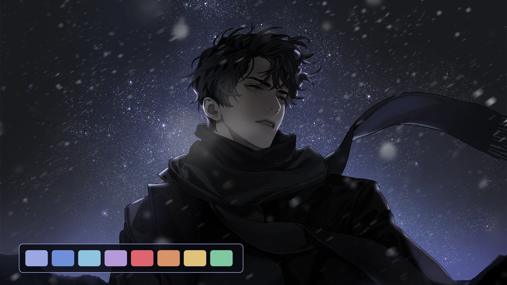
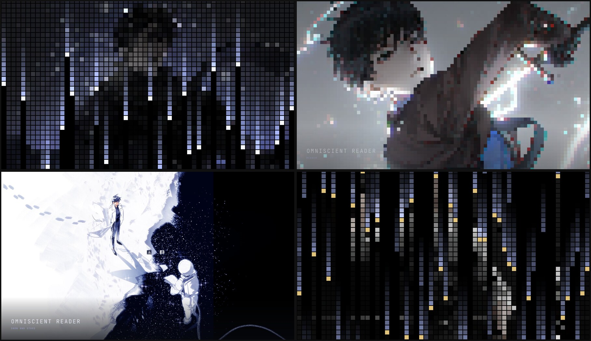

# Omniscient Reader

A dark [Omarchy](https://omarchy.org) theme for Omniscient Reader's Viewpoint,
built around Kim Dokja and Yu Junghyeok. Ink black and paper white — the black
coat against the white one — under the indigo of a night full of
constellations.



## Install

```sh
omarchy theme install https://github.com/mcsmith3/omarchy-omniscient-reader-theme
omarchy theme set omniscient-reader
```

Or copy this directory to `~/.config/omarchy/themes/omniscient-reader` and run
the second command.

## Palette

| Role | Colour | From |
| --- | --- | --- |
| Background | `#0A0B12` | Yu Junghyeok's coat; ink |
| Foreground | `#DFE2EC` | Kim Dokja's coat; paper |
| Accent | `#9AA7E0` | the starlit indigo sky |
| Blue | `#6F8FD8` | Dokja's shirt |
| Cyan | `#8FC4E0` | sword light |
| Magenta | `#B49AD8` | the violet edge of the night sky |
| Red | `#DC6570` | the Demon King's horns and red curtain |
| Yellow | `#E0C27A` | star gold |
| Orange | `#D99368` | a warm step between the red and the gold |
| Green | `#7FC9A0` | added for diffs and success states |

Window borders fade from white into indigo. Notifications are styled after the
Star Stream's scenario windows: indigo panels with a starlit edge.

## What's in here

- `colors.toml` — the palette; Omarchy generates the terminal, editor, btop,
  browser and shell colours from it
- `shell.notifications.toml` — the scenario-window notification style
- `icons.theme` — blue Yaru folder icons
- `backgrounds/` — ten wallpapers; cycle with `omarchy theme bg next`
- `screensaver/` and `scripts/` — the optional pixel-rain screensaver

## Wallpapers

| File | Scene |
| --- | --- |
| `01-regressor.jpg` | Default. Yu Junghyeok under a sky of stars. |
| `02-reader.jpg` | Kim Dokja, blade drawn, in white lightning. |
| `03-snow-and-stars.jpg` | Dokja on a white shore where snow meets a sea of stars. |
| `04-raven.jpg` | Dokja hooded in white with a raven landing on his hand. |
| `05-hero.jpg` | Yu Junghyeok with his sword across his shoulders, in greys. |
| `06-demon-king.jpg` | Dokja as the Demon King of Salvation, black wings spread. |
| `07-ink.jpg` | Yu Junghyeok in black-and-white manhwa ink. |
| `08-red-curtain.jpg` | The two of them seated before a red curtain. |
| `09-black-wings.jpg` | The two of them close together, wrapped in black wings. |
| `10-white-and-black.jpg` | Yu Junghyeok in black holding Dokja in white, wings behind them. |

Several of these are light images; `01`, `05` and `08` are the dark ones if you
want the desktop to stay dim. Add your own to `backgrounds/` and they join the
cycle. Re-run the screensaver installer afterwards and they join that too.

## Pixel-rain screensaver

This is optional. Each wallpaper is built by falling columns of indigo pixels
that lay the scene down as coarse blocks. The blocks sharpen into the full
image, which holds for 12 seconds, then pixelates again and rains off the
screen, tipped in gold, before the next scene arrives.



```sh
python3 ~/.config/omarchy/themes/omniscient-reader/scripts/install-screensaver.py --check
python3 ~/.config/omarchy/themes/omniscient-reader/scripts/install-screensaver.py
omarchy restart shell
ORV_PREVIEW_SECONDS=30 ~/.local/share/omarchy-omniscient-reader/launch-screensaver --preview
```

`--check` changes nothing and reports whether your Omarchy version is
supported. The installer clones Omarchy's idle plugin so that it starts
`~/.local/share/omarchy-theme-screensaver/launch-screensaver`, which runs this
screensaver while Omniscient Reader is the active theme and Omarchy's stock one
otherwise. It backs up what it replaces under
`~/.local/state/omarchy/backups/`. Restart the shell after the first install so
the idle service picks up the change.

Any key, click or mouse movement dismisses it. Timing is in
`screensaver/shell.qml` and the effect is in `screensaver/pixel-rain.frag`.
After editing the shader, rebuild it:

```sh
/usr/lib/qt6/bin/qsb --glsl '100 es,120,150' --hlsl 50 --msl 12 \
  -o screensaver/pixel-rain.frag.qsb screensaver/pixel-rain.frag
```

## Credits

The wallpapers were collected from [Alpha Coders](https://alphacoders.com) and
[Wallhaven](https://wallhaven.cc) and are the work of their original artists.
Omniscient Reader's Viewpoint and its characters belong to their respective
owners. This is an unofficial fan theme, not affiliated with or endorsed by
them.
